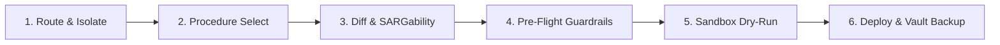

# SafeDeploy Studio

<p align="center">
  
  <strong>Intelligent Database Deployment & Management Platform</strong>
</p>

<p align="center">
  <a href="https://github.com/vishal-07-prajapati/safedeploy-studio/actions"></a>
  <a href="https://dotnet.microsoft.com/download/dotnet/10.0"></a>
  <a href="https://learn.microsoft.com/en-us/sql/sql-server/"></a>
  <a href="https://github.com/vishal-07-prajapati/safedeploy-studio/blob/master/LICENSE"></a>
  <a href="https://vishal-07-prajapati.github.io/safedeploy-studio-site"></a>
</p>

---

## 🌟 Overview

**SafeDeploy Studio** is a reusable, project-independent database deployment platform engineered in **.NET 10 and C# 13**. Designed for software engineering teams, database administrators, and DevOps professionals, it eliminates deployment anxiety by enforcing automated pre-flight safety gates, AST-based guardrails, side-by-side SQL diffing, transactional sandbox dry-runs, and instant 1-click rollbacks.

👉 **Product Showcase Website**: [https://vishal-07-prajapati.github.io/safedeploy-studio-site](https://vishal-07-prajapati.github.io/safedeploy-studio-site)

---

## 🚀 Key Capabilities

- **Abstract Syntax Tree (AST) Guardrails**: Powered by `Microsoft.SqlServer.TransactSql.ScriptDom 180`. Blocks physical `DROP TABLE`, `TRUNCATE TABLE`, and `ALTER TABLE` operations while permitting temporary tables (`#temp`) for ETL.
- **Transactional Sandbox Dry-Run**: Executes migrations inside isolated target transactions (`BEGIN TRAN ... ROLLBACK TRAN`) to catch constraint and syntax errors with guaranteed zero side effects.
- **Pre-Change Backup Vault**: Captures timestamped SHA-256 pre-change snapshots of modified database objects before changes are committed.
- **1-Click Instant Rollback**: Revert any procedural deployment back to its previous verified state with a single click.
- **Side-by-Side SQL Diff**: Powered by `DiffPlex` with whitespace normalization and line-by-line additions, deletions, and modification highlights.
- **Deterministic SARGability Advisor**: Flags index-invalidating anti-patterns (`YEAR(Col) = ...`, non-SARGable `ISNULL`, `SELECT *`, and missing `SET NOCOUNT ON`).
- **Multi-Tenant / Multi-Project**: Complete isolation between organizations, projects, environments (Dev, Staging, Production), and database endpoints.
- **Dual User Experience**:
  - **Web Workbench**: Responsive Blazor Server web application with dark/light themes.
  - **Desktop Shell**: Native Windows WPF application hosting Microsoft WebView2, native menu bar, and system status bar.

---

## 🔄 The 6-Step Guided Deployment Workflow



1. **Route & Isolate**: Select source and target environments with strict project boundary enforcement.
2. **Procedure Select**: Auto-discover stored procedures from `sys.sql_modules` or input migration scripts.
3. **Diff & SARGability**: Side-by-side AST comparison and query index performance review.
4. **Pre-Flight Guardrails**: Enforce DDL blocks, ASCII 7-bit compliance, and unqualified `UPDATE`/`DELETE` checks.
5. **Sandbox Dry-Run**: Run transactional dry-run on target database with verified clean rollback.
6. **Deploy & Vault Backup**: Capture SHA-256 backup snapshot and stream atomic deployment execution.

---

## 🏛️ Clean Architecture Solution Structure

```
SafeDeployStudio.slnx
├── src/
│   ├── SafeDeployStudio.Domain                   # Aggregates, Entities, Value Objects, Enums
│   ├── SafeDeployStudio.DatabaseProviders/
│   │   ├── SafeDeployStudio.DatabaseProviders.Abstractions  # IDatabaseProvider, Metadata
│   │   └── SafeDeployStudio.DatabaseProviders.SqlServer     # SqlClient, Dapper, ScriptDom
│   ├── SafeDeployStudio.Guardrails               # ScriptDom AST Visitors & Rule Engine
│   ├── SafeDeployStudio.Deployment               # DiffPlex Diff Engine & Orchestrator
│   ├── SafeDeployStudio.Backup                   # Pre-Change Vault & 1-Click Rollback
│   ├── SafeDeployStudio.AI                       # SARGability Analyzer & LLM Advisor
│   ├── SafeDeployStudio.Application              # DTOs, CQRS Use Cases, Workflow Service
│   ├── SafeDeployStudio.Infrastructure           # EF Core SQLite / SQL Server Repositories
│   ├── SafeDeployStudio.Api                      # ASP.NET Core REST API & SignalR Hub
│   ├── SafeDeployStudio.Web                      # Blazor Server UI (Dark/Light Themes)
│   └── SafeDeployStudio.Desktop                  # Windows WPF + WebView2 Desktop Shell
└── tests/
    ├── SafeDeployStudio.UnitTests                # xUnit, FluentAssertions, Moq
    └── SafeDeployStudio.IntegrationTests         # EF Core Seeder & DB Integration Tests
```

---

## ⚡ Quick Start

### Web Workbench
```bash
dotnet run --project src/SafeDeployStudio.Web/SafeDeployStudio.Web.csproj
```
Navigate to: `https://localhost:7199`

### Windows Desktop Client
```bash
dotnet run --project src/SafeDeployStudio.Desktop/SafeDeployStudio.Desktop.csproj
```

### Run Tests
```bash
dotnet test SafeDeployStudio.slnx
```

---

## 📚 Documentation
- [Architecture & Technical Specifications](docs/ARCHITECTURE.md)
- [Getting Started Guide](docs/GETTING_STARTED.md)
- [Guardrails & Safety Rules Reference](docs/GUARDRAILS_GUIDE.md)
- [Windows Server IIS Deployment Guide](docs/IIS_DEPLOYMENT_GUIDE.md)

---

## 📄 License
SafeDeploy Studio is released under the [MIT License](LICENSE).
